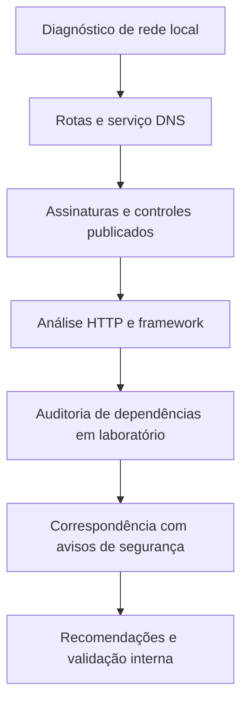

# Análise técnica real de infraestrutura de um provedor de internet

> **Status:** CONCLUÍDA — investigação documental realizada em **15/10/2026**.
>
> **Contexto:** empresa provedora de internet localizada em **Porto Alegre, Rio Grande do Sul, Brasil**.

Este repositório documenta **como foi investigada uma infraestrutura de rede e seu site institucional**, desde a conexão do assinante até a análise das versões dos serviços. Cada etapa apresenta os comandos utilizados, os resultados encontrados e sua interpretação. O documento termina com os problemas identificados e as soluções propostas.

**Principais achados:** assinatura de **BIND 9.9.4** em um resolvedor DNS; identificação de **Astro 5.18.2**, React e Cloudflare no site; ausência dos cabeçalhos **HSTS** e **CSP** na resposta analisada.

## Sumário

- [1. Problema e objetivo](#1-problema-e-objetivo)
- [2. Preparação e anonimização](#2-preparação-e-anonimização)
- [3. Método de investigação](#3-método-de-investigação)
- [4. Investigação passo a passo](#4-investigação-passo-a-passo)
- [5. Problemas e riscos identificados](#5-problemas-e-riscos-identificados)
- [6. Soluções e plano de correção](#6-soluções-e-plano-de-correção)
- [7. Resultado e critérios de validação](#7-resultado-e-critérios-de-validação)
- [8. Referências técnicas](#8-referências-técnicas)

---

## 1. Problema e objetivo

Provedores de internet dependem de serviços essenciais (DNS, roteamento e aplicações web). **Versões de serviços, dependências e cabeçalhos HTTP** foram os principais pontos investigados.

O estudo procurou responder:

- Como a rede do assinante alcança o DNS e a internet pública?
- Que serviço responde na porta 53, e que versão ele anuncia?
- Quais tecnologias o site institucional efetivamente publica?
- Quais avisos de segurança estão associados às versões identificadas?
- Quais medidas podem corrigir os problemas encontrados?

## 2. Preparação e anonimização

Os registros de rede, DNS e web tiveram nomes comerciais, domínios, IPs específicos, ASN, endereços da residência, MAC, SSID e identificadores de equipamento removidos. Foram mantidos os nomes de ferramentas, as versões de software, as faixas IP genéricas e os resultados necessários para entender o estudo.

### Identificadores utilizados nos comandos

Os comandos preservam a técnica e a sintaxe com **alvos substituídos por variáveis de exemplo**. Endereços como `192.0.2.53` pertencem a faixas reservadas para documentação e **não identificam a empresa analisada**.

```bash
# Apenas valores de exemplo; substitua SOMENTE em ambientes próprios ou autorizados.
SITE_HOST="site.example.invalid"
DOMAIN="example.invalid"
DNS_IP="192.0.2.53"
DNS_HOST="dns.example.invalid"
DNS_ID_HOST="identificador.example.invalid"
NS_AUTH="ns1.example.net"
IFACE="wlan0"
ASSET_PATH="/_astro/client.<hash>.js"
```

### Ferramentas utilizadas

Na investigação foram utilizados comandos comuns do Linux, `dig`, `traceroute`, `curl`, `nmap`, `nc` e, na última etapa, Node.js/npm. Estes são os comandos de instalação e verificação registrados na preparação do Fedora (nem todos tiveram sua execução confirmada no histórico):

```bash
sudo dnf install traceroute
sudo dnf install bind-utils
sudo dnf install nmap
sudo dnf install nodejs24-bin nodejs24-npm-bin
node --version
npm --version
sudo ss -lntup                           # Apenas na máquina que você administra
```

> **Anonimização:** a associação entre versões de software, cidade e outros fatos públicos ainda pode permitir correlação externa. Os identificadores específicos foram omitidos para reduzir essa possibilidade.

## 3. Método de investigação

A investigação seguiu a ordem: **conexão local → roteamento → consultas DNS → identificação do serviço → portas → site e cabeçalhos → auditoria de dependências**. Os resultados foram registrados junto dos comandos de cada etapa.



## 4. Investigação passo a passo

### 4.1. Etapa 1 — Conectividade e roteamento

Primeiro foram identificados a interface ativa, o gateway, os resolvedores configurados e os caminhos até a internet e o DNS do provedor.

**Comandos registrados:**

```bash
ip -4 route
nmcli -g IP4.DNS device show "$IFACE"
nmcli device show "$IFACE"
curl -4 https://api.ipify.org              # Não publique o IP real retornado
traceroute -n 1.1.1.1                  # DNS público de referência
traceroute -n "$DNS_IP"                # DNS da operadora, alvo anonimizado
```

**Resultados:**

- Gateway IPv4 local, prefixo privado e interface Wi-Fi foram identificados.
- O primeiro salto após o roteador doméstico usava a faixa **`100.64.0.0/10`**, comum em redes com CGNAT. Isso **não confirma** CGNAT: faltou comparar a WAN do roteador com o IP de saída pública.
- Saltos intermediários utilizavam `10.0.0.0/8`; o caminho até um resolvedor do provedor foi de **cinco saltos**, versus **11 saltos** até um DNS público externo.
- A conexão possuía IPv6 global e conseguiu consultar um servidor autoritativo por IPv6.

Diagrama **conceitual**, com todos os endereços privados e públicos particulares omitidos:

```text
[Computador do assinante]
         |
[Roteador residencial / gateway LAN]
         |
[Primeiro salto da operadora: faixa 100.64.0.0/10]
         |
[Roteamento interno: faixa 10.0.0.0/8]
         +----> [Resolvedor DNS da operadora: UDP/TCP 53]
         |
         +----> [Trânsito / interconexão] ---> [Internet]
```


### 4.2. Etapa 2 — Funcionamento e identificação do DNS

Em seguida foram verificadas a resolução recursiva por UDP e TCP, a correspondência de nomes, a autoridade DNS do domínio e a versão anunciada pelo resolvedor.

**Comandos registrados:**

```bash
dig @"$DNS_IP" example.com
dig +tcp @"$DNS_IP" example.com

dig -x "$DNS_IP" +short
dig +short "$DNS_HOST" A

dig +short NS "$DOMAIN"
dig @"$NS_AUTH" "$DOMAIN" SOA +norecurse

dig @"$DNS_IP" version.bind TXT CH +short
dig @"$DNS_IP" hostname.bind TXT CH +short

dig +short "$DNS_ID_HOST" A
dig "$DNS_ID_HOST" A +noall +comments +answer +authority
```

**Resultados:**

| Item | Resultado anonimizado | Interpretação |
|---|---|---|
| Resolução `example.com` via UDP | `NOERROR`, flags `qr rd ra`, resposta em **4 ms** | Recursão disponível ao cliente observado |
| Resolução via TCP | `NOERROR`, flags `qr rd ra`, resposta em **3 ms** | DNS também disponível por TCP/53 |
| TTL das respostas | **138 s** e **93 s**, intervalo entre consultas de aproximadamente 45 s | Compatível com cache; não comprova cache local isoladamente |
| DNS reverso e direto | Hostname e IP corresponderam | Coerência de registros PTR e A consultados |
| DNS público do domínio | Nameservers autoritativos de uma CDN; consulta SOA retornou flag `aa` | Serviço autoritativo separado da função recursiva |
| `hostname.bind` | Identificador interno divulgado, **anonimizado** | Nome anunciado pelo serviço, não necessariamente domínio público |
| Consulta A ao identificador | `NXDOMAIN`, com SOA da zona superior | Identificador não existia no DNS público consultado |
| `version.bind` | `BIND 9.9.4`, pacote **Enterprise Linux 7** (sufixo exato removido) | Assinatura de software; SO e atualização não comprovados |

A assinatura original anunciava uma revisão antiga do BIND, historicamente associada à família RHEL/CentOS 7. 

### 4.3. Etapa 3 — Portas e sistema operacional

Foi registrada a condição das portas TCP e a tentativa de identificação do sistema operacional do servidor DNS.

**Comandos registrados:**

```bash
sudo nmap -O "$DNS_IP"               # Observação de portas/fingerprint
nc -vz -w 3 "$DNS_IP" 22              # Tentativa simples de conexão TCP
```

**Resultados:**

No levantamento pontual, o Nmap examinou suas **1.000 portas TCP usuais** e retornou uma porta aberta e uma filtrada:

```text
PORT     STATE      SERVICE
22/tcp   filtered   ssh
53/tcp   open       domain
Not shown: 998 closed tcp ports
No exact OS matches for host
Network Distance: 5 hops
```

O teste de conexão TCP na porta 22 encerrou com `TIMEOUT`. Isso **não demonstra que SSH esteja ativo** ou que a porta esteja aberta. A detecção de SO pelo Nmap **não conseguiu identificar a distribuição**; a string `x86_64-redhat-linux-gnu` no fingerprint da ferramenta descreve o ambiente de compilação **do Nmap**, não o servidor remoto.

### 4.4. Etapa 4 — Tecnologias do site

Depois, o HTML e os arquivos JavaScript publicados foram examinados para identificar o framework, os componentes de interface e a tecnologia de entrega.

**Comandos registrados:**

```bash
curl -fsSL "https://$SITE_HOST/" \
  | grep -Eoi 'wp-content|wp-includes|wp-json|_next/|__NEXT_DATA__|_astro/|_nuxt/|data-sveltekit|data-reactroot|vite' \
  | sort -u

curl -fsSL "https://$SITE_HOST/" \
  | grep -Eo '(<meta[^>]+generator[^>]*>|<astro-island|/_astro/[^" ]+)' \
  | head -n 15

curl -fsSL "https://$SITE_HOST/" \
  | grep -oE 'renderer-url="[^"]+"' \
  | sort -u

curl -fsSL "https://$SITE_HOST$ASSET_PATH" | head -c 2000

curl -fsSL "https://$SITE_HOST/" \
  | grep -Eoi 'data-astro-transition[a-z-]*|astro:transitions|view-transitions' \
  | sort -u

curl -fsSL "https://$SITE_HOST/" | grep -i 'content-security-policy'
```

**Resultados:**

| Camada | Evidência pública | Resultado |
|---|---|---|
| Framework | `<meta name="generator" content="Astro v5.18.2">` | **Astro 5.18.2 anunciado** |
| Interatividade | `<astro-island>` e `renderer-url` | Astro Islands |
| UI | Licença `React` e `scheduler.production.js` no JS público | React no bundle; versão indeterminada |
| Assets | `/_astro/*.js` e `/_astro/*.css` | Arquivos compilados do site |
| Entrega HTTP | `server: cloudflare` | Cloudflare na borda; origem oculta |
| SSR/SSG, adaptador, banco, sistema operacional | Sem evidência suficiente | **Desconhecidos** |


As buscas por diretivas de transição e CSP não retornaram correspondências na página inicial. A mensagem `curl: (23)` surgiu quando `head -c 2000` encerrou a leitura do arquivo JS antes do `curl`. O caminho do asset foi substituído por um marcador.

### 4.5. Etapa 5 — Cabeçalhos e controles HTTP

Foram capturadas as respostas HTTP e avaliados os cabeçalhos de segurança recebidos na página inicial.

**Comandos registrados:**

```bash
curl -I "http://$SITE_HOST/"
curl -I "https://$SITE_HOST/"
curl -sS -D - -o /dev/null "https://$SITE_HOST/"

mkdir -p ~/auditoria-site
curl -fsSL \
  -D ~/auditoria-site/headers.txt \
  -o ~/auditoria-site/index.html \
  "https://$SITE_HOST/"

grep -Eoi 'Astro v[0-9.]+' ~/auditoria-site/index.html | sort -u
grep -Ei '^(HTTP/|strict-transport-security:|content-security-policy:|x-content-type-options:|referrer-policy:)' \
  ~/auditoria-site/headers.txt
```

**Resultados:**

```http
HTTP/1.1 301 Moved Permanently
Location: https://site.example.invalid/
Server: cloudflare
```

```http
HTTP/2 103 Early Hints
link: <https://fonts.googleapis.com>; rel=preconnect

HTTP/2 200
content-type: text/html; charset=utf-8
x-content-type-options: nosniff
referrer-policy: strict-origin-when-cross-origin
access-control-allow-origin: *
cache-control: public, max-age=0, must-revalidate
server: cloudflare
cf-cache-status: DYNAMIC
```

- **HTTPS:** redirecionamento `301` e resposta `200` observados corretamente.
- **HSTS:** não apareceu nos cabeçalhos HTTPS examinados.
- **CSP:** não apareceu nos cabeçalhos e não foi encontrada na busca textual do HTML inicial.
- **CORS `*`:** cabeçalho observado na resposta da página pública.
- **`103 Early Hints`:** resposta intermediária para otimização do carregamento de fontes.
- **Cloudflare:** cabeçalho da infraestrutura de entrega HTTP.

### 4.6. Etapa 6 — Auditoria local das dependências

Por fim, foi reproduzida em um **laboratório próprio** a versão do Astro anunciada pelo site e consultada a base de avisos de segurança do npm. Esse procedimento permitiu analisar as dependências **sem executar testes de exploração no servidor de produção e sem risco de interromper seu funcionamento**.

**Comandos registrados:**

```bash
mkdir -p ~/auditoria-astro
cd ~/auditoria-astro

npm init -y
npm install astro@5.18.2 --package-lock-only --ignore-scripts --no-audit
npm audit --omit=dev

node -e '
const packages = require("./package-lock.json").packages;
for (const name of ["astro", "sharp", "esbuild"]) {
  const info = packages["node_modules/" + name];
  console.log(name + ": " + (info?.version ?? "não encontrado"));
}
'

npm audit --omit=dev --json > audit-local.json
```

**Resultados:**

| Dependência | Versão **resolvida localmente** | Estado no `npm audit` local |
|---|---|---|
| `astro` | `5.18.2` | Crítica (severidade agregada) |
| `sharp` | `0.34.5` | Alta |
| `esbuild` | `0.27.7` | Baixa |

```text
3 vulnerabilities (1 low, 1 high, 1 critical)
```

O relatório do npm agregou as ocorrências em **três pacotes**, cada um relacionado a múltiplos avisos. As versões de `sharp` e `esbuild` são as resolvidas **neste projeto de comparação**, não um inventário do servidor real. Para aplicar uma CVE ao site seria necessário confirmar os pacotes efetivamente implantados e as condições descritas em seu aviso. Esta distinção também explica por que a auditoria foi realizada localmente, sem testar a falha em produção.

## 5. Problemas e riscos identificados

As versões e configurações observadas foram comparadas com os seguintes avisos técnicos. Cada linha informa a condição necessária para que a falha ocorra e o impacto previsto.

| Risco / aviso | Pré-condição necessária | Consequência prática **se aplicável** | Evidência no alvo |
|---|---|---|---|
| BIND: [CVE-2020-8616](https://kb.isc.org/docs/cve-2020-8616) | Código afetado, sem correção aplicável, condições de consulta do aviso | Sobrecarga ou indisponibilidade de resolução DNS | **Não confirmada** |
| BIND: [CVE-2020-8617](https://kb.isc.org/docs/cve-2020-8617) | Código afetado sem atualização correspondente | Possível interrupção do serviço DNS | **Não confirmada** |
| BIND: [CVE-2025-40778](https://kb.isc.org/docs/cve-2025-40778) | Implementação e comportamento recursivo afetados; versões 9.9 não avaliadas especificamente | Resposta DNS falsificada no cache, potencial direcionamento incorreto de nomes | **Não confirmada** |
| BIND: [CVE-2025-40780](https://kb.isc.org/docs/cve-2025-40780) | Condições do aviso; versão 9.9 não avaliada especificamente | Redução da resistência contra respostas DNS forjadas | **Não confirmada** |
| Astro: [GHSA-26w7-cxv4-gfx2](https://github.com/advisories/GHSA-26w7-cxv4-gfx2) | Otimização vulnerável de imagens AVIF **não confiáveis** | Execução de código no ambiente de processamento; pode ser o build, não o site publicado | Versão Astro anunciada; **rotina não confirmada** |
| Astro: [CVE-2026-54299](https://github.com/advisories/GHSA-2pvr-wf23-7pc7) | SSR e páginas de erro/adaptador afetados | SSRF: servidor faz requisições inesperadas | **Implantação SSR não confirmada** |
| Astro: [CVE-2026-54298](https://github.com/advisories/GHSA-jrpj-wcv7-9fh9) | Nomes de atributos derivados de chaves não confiáveis | XSS: execução indevida de JavaScript no navegador | **Fluxo de dados não confirmado** |
| Astro: [CVE-2026-59727](https://github.com/advisories/GHSA-7pw4-f3q4-r2p2) | Diretivas de transição com dados não confiáveis | XSS em circunstâncias específicas | **Diretivas não observadas no HTML inicial** |
| Astro: [CVE-2026-73422](https://github.com/advisories/GHSA-4g3v-8h47-v7g6) | Propriedades de animação contaminadas | XSS refletido possível | **Não confirmado** |
| Astro: [GHSA-j687-52p2-xcff](https://github.com/advisories/GHSA-j687-52p2-xcff) | Uso afetado de `define:vars` com entradas não confiáveis | XSS | **Não confirmado** |
| Astro: [GHSA-xr5h-phrj-8vxv](https://github.com/advisories/GHSA-xr5h-phrj-8vxv) | *Server islands* e parâmetros atingindo cenário de replay | Possível acesso indevido entre componentes | **Não confirmado** |
| Astro: [GHSA-f48w-9m4c-m7f5](https://github.com/advisories/GHSA-f48w-9m4c-m7f5) | Renderização afetada de atributos | XSS | **Não confirmado** |
| Astro: [GHSA-8hv8-536x-4wqp](https://github.com/advisories/GHSA-8hv8-536x-4wqp) | SSR/slots e versão específica incluída no aviso | XSS | **Aplicabilidade à linha 5.x pendente** |
| Astro: [GHSA-376h-93r7-7g6f](https://github.com/advisories/GHSA-376h-93r7-7g6f) | Base de roteamento e autorização por caminho em middleware | Possível desvio de controle de acesso | **Não confirmado** |
| Sharp: [GHSA-f88m-g3jw-g9cj](https://github.com/advisories/GHSA-f88m-g3jw-g9cj) e avisos de libheif/librsvg | Processamento de arquivos em bibliotecas afetadas | Falhas de memória ou processamento conforme avisos | **Somente laboratório** |
| esbuild: [GHSA-g7r4-m6w7-qqqr](https://github.com/advisories/GHSA-g7r4-m6w7-qqqr) | Servidor de desenvolvimento em **Windows** | Leitura indevida de arquivos em ambiente de desenvolvimento | **Sem evidência de aplicabilidade ao site** |


### Controles HTTP: problema e correção

| Proteção | Problema observado | Solução recomendada |
|---|---|---|
| HSTS | Redirecionamento a HTTPS sem cabeçalho HSTS na página examinada; possível exposição adicional da primeira navegação HTTP em alguns contextos | Avaliar política HSTS depois de validar todo o fluxo HTTPS |
| CSP | Cabeçalho ausente e nenhum identificador encontrado no HTML inicial; menor defesa adicional contra XSS **caso** exista uma falha | Criar CSP ajustada aos scripts legítimos, começar com `Content-Security-Policy-Report-Only` |
| CORS | `Access-Control-Allow-Origin: *` em página pública | Não tratar como CVE; restringir por rota se endpoints sensíveis exigirem |

## 6. Soluções e plano de correção

A correção deve começar pelos componentes identificados, com atualização controlada e verificação dos cabeçalhos de segurança.

| Prioridade de triagem | Problema | Ação proposta | Evidência de correção |
|---|---|---|---|
| **Alta** | Astro em versão associada a múltiplos avisos | Conferir lockfile/build implantados; atualizar a versão suportada e dependências, validando alterações incompatíveis | Auditoria do projeto **real**, testes automatizados e nova publicação identificada |
| **Alta** | Processamento de imagens potencialmente afetado | Verificar onde/como AVIF é processado; versões reais de Sharp, libvips, libheif e librsvg | Inventário e testes com arquivos próprios em ambiente controlado |
| **Alta** | BIND anuncia revisão de geração antiga | Conferir pacote **instalado**, changelog, backports e suporte do SO; aplicar correções ou migrar para ramo suportado | Inventário de pacotes, boletins aplicados e monitoramento de DNS |
| **Média** | Incógnita sobre SSR/adaptadores e fluxo de dados | Revisar SSR/SSG, páginas de erro, middleware de autorização, slots, atributos e transições | Revisão de código e testes autorizados das funções relevantes |
| **Média** | CSP ausente | Implementar CSP incremental e monitorar violações antes de forçar bloqueios | Cabeçalho presente nas rotas e teste funcional sem regressão |
| **Baixa a média** | HSTS ausente | Introduzir HSTS com `max-age` progressivo após avaliação do domínio/subdomínios | Respostas HTTPS com política correta; testes de navegação |
| **Informativa** | `Access-Control-Allow-Origin: *` público | Revisar CORS por recurso, sem classificá-lo isoladamente como falha | Política proporcional à sensibilidade de cada endpoint |

### Exemplos conceituais de configuração

Exemplos iniciais de configuração para avaliação pela equipe técnica:

```http
Strict-Transport-Security: max-age=300
Content-Security-Policy-Report-Only: default-src 'self'; object-src 'none'
```

Para o DNS, a solução é validar a revisão **real** do pacote, compatibilidade, ACLs de recursão, acesso administrativo e estratégia de atualizações. Mudanças no serviço DNS exigem plano de atualização e rollback para preservar a disponibilidade.

## 7. Resultado e critérios de validação

### Diagnóstico resumido

| ID | Observação | Evidência | Estado |
|---|---|---|---|
| `NET-01` | Rede de acesso com saltos privados e faixa de endereçamento compartilhado | `ip`, `nmcli`, `traceroute` | **CONFIRMADO nos resultados**; CGNAT apenas provável |
| `DNS-01` | Resolvedor com recursão em UDP/53 e TCP/53 | `dig` | **CONFIRMADO a partir da conexão avaliada** |
| `DNS-02` | Serviço anuncia BIND 9.9.x, empacotamento da família Enterprise Linux 7 | `version.bind` e registro histórico de serviço | **ASSINATURA CONFIRMADA**; binário e atualizações não validados |
| `DNS-03` | Porta 22/TCP não forneceu resposta conclusiva | `nmap`, `nc` | **FILTRADA/INDETERMINADA** |
| `WEB-01` | Site anuncia Astro 5.18.2, usa React e entrega conteúdo via Cloudflare | HTML, JS e cabeçalhos | **CONFIRMADO como evidência publicada** |
| `WEB-02` | HSTS e CSP não observados na página inicial | `curl`, busca no HTML | **CONFIRMADO no escopo observado** |
| `WEB-03` | Dependências com alertas em projeto comparável | `npm audit` local | **CONFIRMADO APENAS EM LABORATÓRIO** |

### Critérios de validação

| Verificação | Critério de conclusão | Situação em 15/10/2026 |
|---|---|---|
| `REQ-NET-01` — CGNAT | Comparar WAN IP do roteador com IP público | **PENDENTE** |
| `REQ-DNS-01` — DNS funcional | Resposta consistente em UDP/TCP 53 | **CONCLUÍDA** na conexão avaliada |
| `REQ-DNS-02` — versão real e correções do BIND | Pacotes e changelog obtidos por administrador autorizado | **PENDENTE** |
| `REQ-WEB-01` — framework divulgado | Metadado de versão no HTML | **CONCLUÍDA** (versão **anunciada**) |
| `REQ-WEB-02` — cabeçalhos HTTP | Registrar HTTPS, CSP, HSTS e demais controles | **CONCLUÍDA** para a página inicial |
| `REQ-WEB-03` — dependências de produção | Lockfile e ambiente real verificados pela equipe responsável | **PENDENTE** |
| `REQ-WEB-04` — exploração de CVEs | Revisão interna e teste autorizado das pré-condições | **PENDENTE**; não realizado |

**Conclusão:** a investigação identificou uma assinatura de BIND de geração antiga, uma versão do Astro relacionada a diversos avisos de segurança e controles HTTP ausentes na página inicial. As ações prioritárias são verificar as versões efetivas, aplicar correções pertinentes e configurar HSTS/CSP. A análise documentou a infraestrutura observável e os riscos conhecidos; **não foi realizada exploração de vulnerabilidades contra a empresa**.

## 8. Referências técnicas

- **Padrão `agents.specs`:** documento `specs.md` fornecido como referência editorial (classificação, estrutura, navegação e apresentação).
- [Astro — Security Advisories](https://github.com/withastro/astro/security/advisories)
- [Astro — documentação de renderização](https://docs.astro.build/en/guides/on-demand-rendering/)
- [npm — `npm audit`](https://docs.npmjs.com/cli/commands/npm-audit/)
- [ISC — avisos de segurança do BIND](https://kb.isc.org/docs/aa-00913)
- [Red Hat — ciclo de vida do RHEL](https://access.redhat.com/support/policy/updates/errata/)
- [IETF RFC 6598 — Shared Address Space](https://www.rfc-editor.org/rfc/rfc6598)
- [IETF RFC 5737 — IPv4 reservado para documentação](https://www.rfc-editor.org/rfc/rfc5737)
- [MDN — Content Security Policy](https://developer.mozilla.org/en-US/docs/Web/HTTP/Guides/CSP)
- [MDN — Strict-Transport-Security](https://developer.mozilla.org/en-US/docs/Web/HTTP/Headers/Strict-Transport-Security)

---

**Data da análise:** 15/10/2026. **Natureza:** documentação pública de uma investigação técnica anonimizada.
